# P1.2 — Migración de Hugo + SQLite a Chyrp Lite

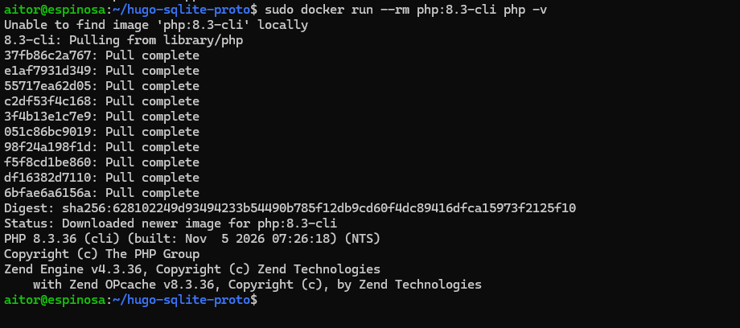

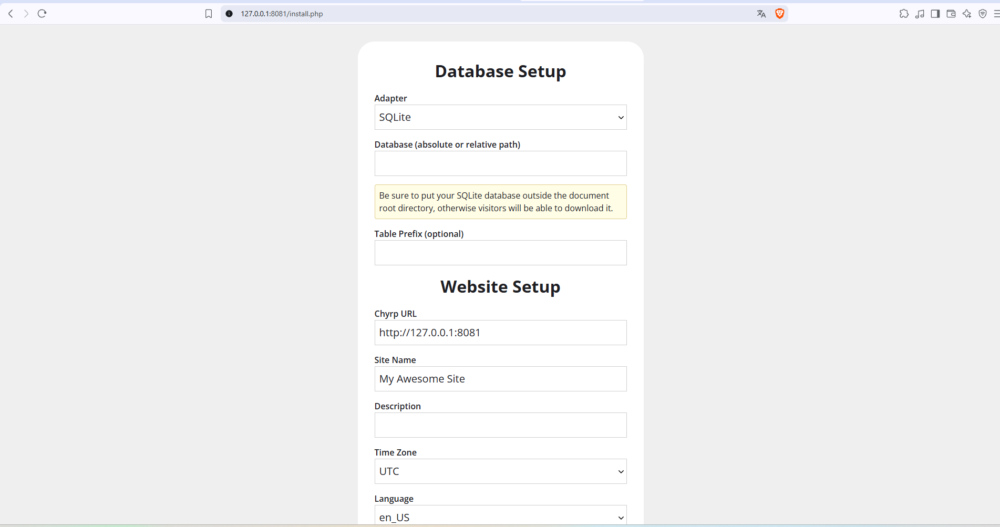

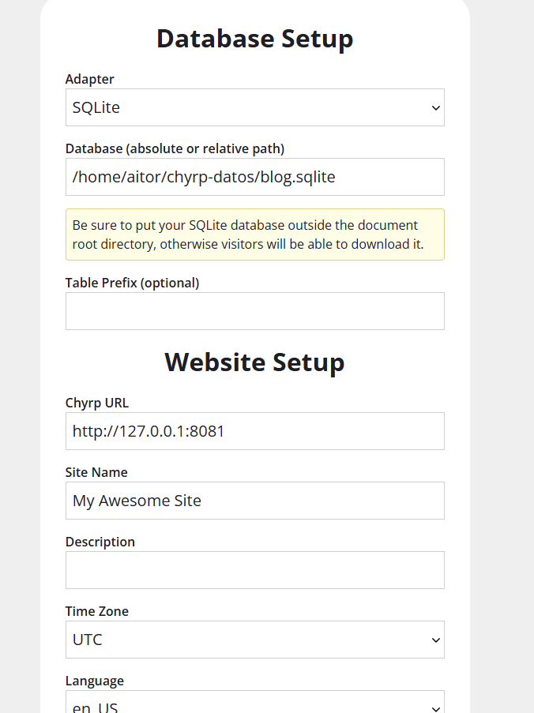

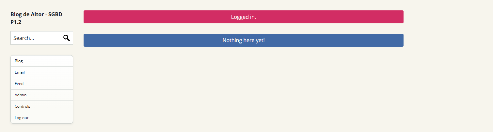

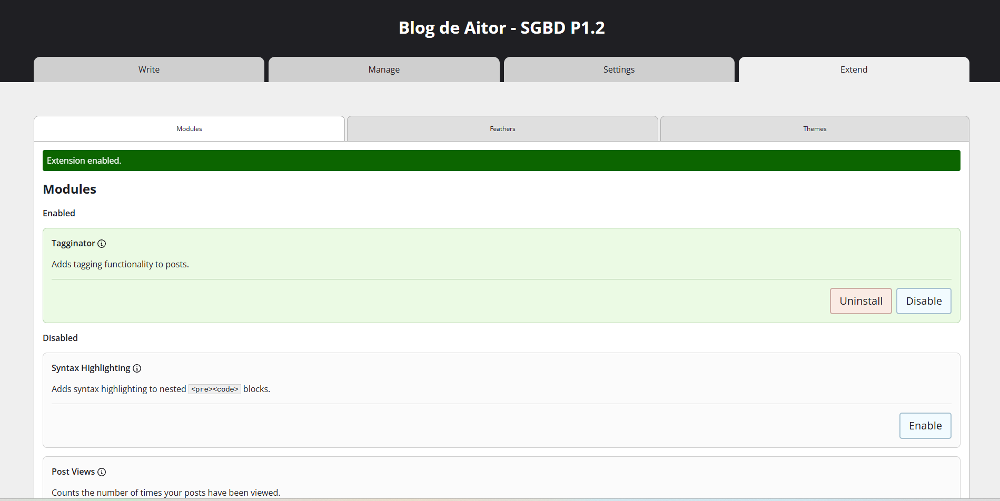

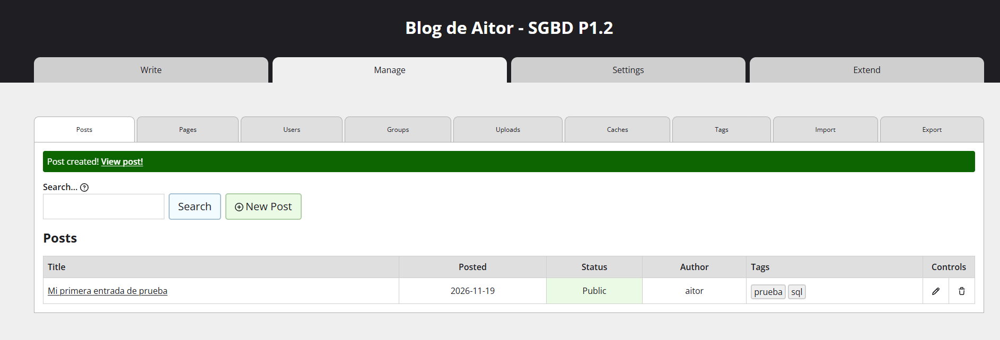

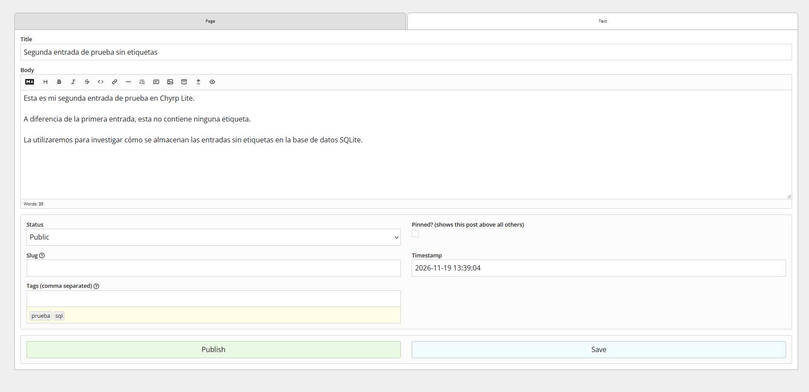

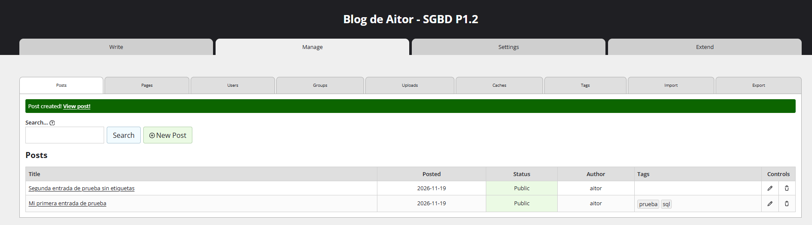

|                         |                                       |
|-------------------------|---------------------------------------|
| **Dato**                | **Valor**                             |
| Versión de PHP          | 8.3.36                                |
| Versión de Chyrp Lite   | 2026.03.01                            |
| Ruta del fichero SQLite | `/home/aitor/chyrp-datos/blog.sqlite` |

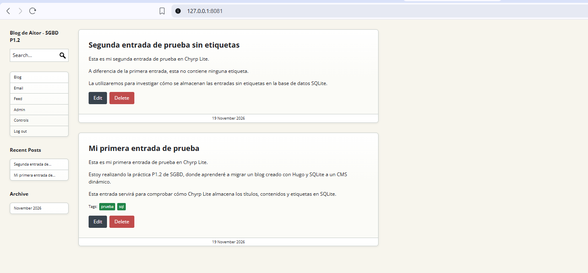

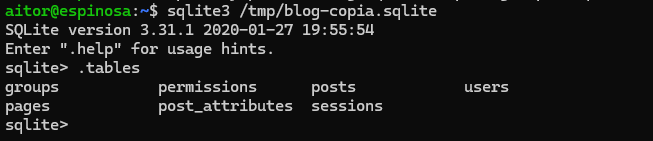

Tabla y Para qué sirve

`groups `Gestionar grupos de usuarios.

`permissions `Almacenar los permisos de acceso.

`posts `Guardar las entradas del blog.

`post_attributes `Guardar atributos de las entradas, como título, cuerpo y etiquetas.

`users `Almacenar los usuarios del blog.

`pages `Guardar páginas independientes.

`sessions `Gestionar las sesiones de los usuarios

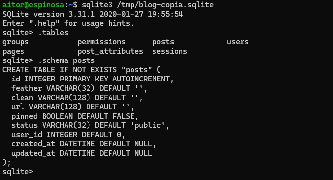

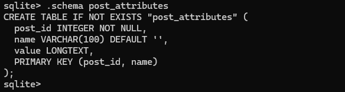

**Pregunta: ¿Qué clave primaria tiene** `post_attributes`**? ¿Por qué es compuesta? ¿Qué clave foránea lleva?**

La tabla `post_attributes` tiene una clave primaria compuesta por `(post_id, name)`.

Es compuesta porque utiliza dos columnas para identificar cada registro. Esto permite que una misma entrada tenga varios atributos, como título, cuerpo y etiquetas, pero evita que se repita el mismo atributo para una entrada.

La columna `post_id` relaciona cada atributo con el `id` de la tabla `posts`. Sin embargo, en el esquema no aparece declarada explícitamente una restricción `FOREIGN KEY`.

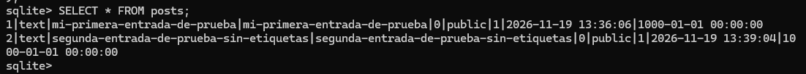

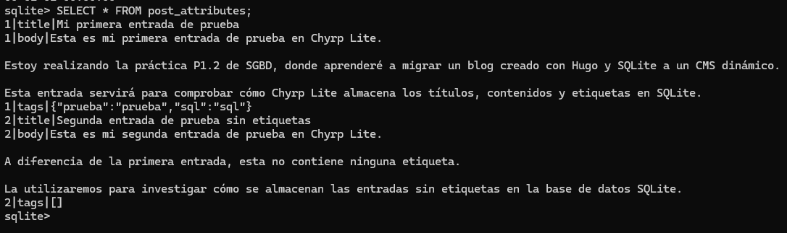

### **¿Cuántas filas ocupa cada entrada en cada tabla? ¿Dónde está el título y el cuerpo?**

Cada entrada ocupa **1 fila en la tabla** `posts`** y 3 filas en** `post_attributes`.

En `posts` se guarda la información general de cada entrada, como su identificador, estado, autor y fechas.

En `post_attributes` se almacenan tres atributos por entrada:

- `title`: contiene el título.
- `body`: contiene el contenido.
- `tags`: contiene las etiquetas.

En nuestro caso tenemos 2 filas en `posts` y 6 filas en `post_attributes`.

### **¿Existe una tabla de etiquetas? ¿Cómo se almacenan?**

No existe una tabla independiente de etiquetas. Chyrp Lite las almacena en `post_attributes`, dentro del atributo `tags`.

En la primera entrada, que tiene las etiquetas `prueba` y `sql`, se guarda:

`{"prueba":"prueba","sql":"sql"}`

Es un objeto en formato JSON.

En la segunda entrada, que no tiene etiquetas, se guarda:

`[]`

Es un array JSON vacío. Por tanto, incluso cuando una entrada no tiene etiquetas, existe una fila para el atributo `tags`.

### **¿Qué ventaja e inconveniente tiene el modelo EAV?**

El modelo EAV (Entidad-Atributo-Valor) permite añadir nuevos atributos sin modificar la estructura de la tabla. Esto resulta útil en un CMS que utiliza módulos.

Su inconveniente es que las consultas pueden ser más complicadas, porque la información de una entrada está repartida entre varias filas en lugar de almacenarse en columnas independientes.

**¿Cómo se guarda la fecha? ¿Con qué formato? ¿Qué valor tiene** `updated_at`** en una entrada que nunca se ha editado?**

Chyrp Lite guarda las fechas en las columnas `created_at` y `updated_at`, utilizando el formato `AAAA-MM-DD HH:MM:SS`.

En nuestra primera entrada, `created_at` contiene `2026-11-19 13:36:06`.

Como todavía no hemos modificado las entradas, `updated_at` tiene el valor `1000-01-01 00:00:00`, que se utiliza para indicar que no se han actualizado.

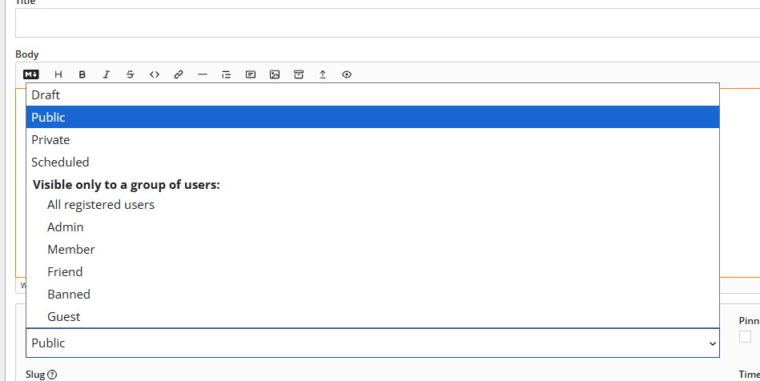

**Pregunta del profesor: ¿Qué diferencia hay entre las columnas** `clean`** y** `url`** de** `posts`**? ¿Qué valores puede tomar** `status`**?**

La columna `clean` contiene una versión normalizada del identificador de la entrada, mientras que `url` guarda el identificador o slug utilizado en su dirección web.

En nuestras dos entradas, ambas columnas tienen el mismo valor. Por ejemplo, en la primera aparece `mi-primera-entrada-de-prueba`.

La columna `status` indica el estado o la visibilidad de una entrada. Las opciones que aparecen en Chyrp Lite son:

- **Draft:** entrada en borrador.
- **Public:** entrada pública, visible para todos.
- **Private:** entrada privada.
- **Scheduled:** entrada programada para publicarse.
- **Visibilidad por grupos:** permite restringir una entrada a determinados grupos de usuarios, como Admin, Member o Friend.

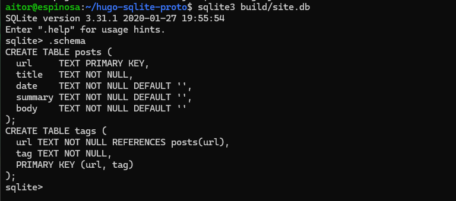

### **1. ¿Cuál es la clave primaria de posts? ¿Y de tags?**

La clave primaria de `posts` es `url`, que identifica de forma única cada entrada.

La tabla `tags` tiene una clave primaria compuesta por `(url, tag)`. Esto evita que una misma entrada tenga dos veces la misma etiqueta.

Además, `tags.url` es una clave foránea que hace referencia a `posts.url`.

### **2. ¿Qué tipo de relación hay entre entradas y etiquetas? ¿Existe una tabla propia de etiquetas?**

Existe una relación de muchos a muchos (N:M): una entrada puede tener varias etiquetas y una misma etiqueta puede aparecer en distintas entradas.

Tenemos una tabla `tags` que guarda las asociaciones entre entradas y etiquetas, pero no una tabla independiente con los datos de cada etiqueta. La etiqueta se almacena directamente como texto en la columna `tag`.

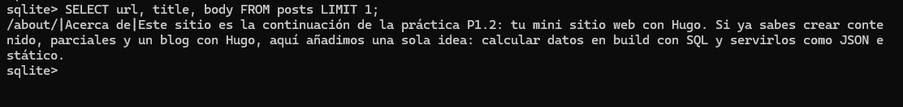

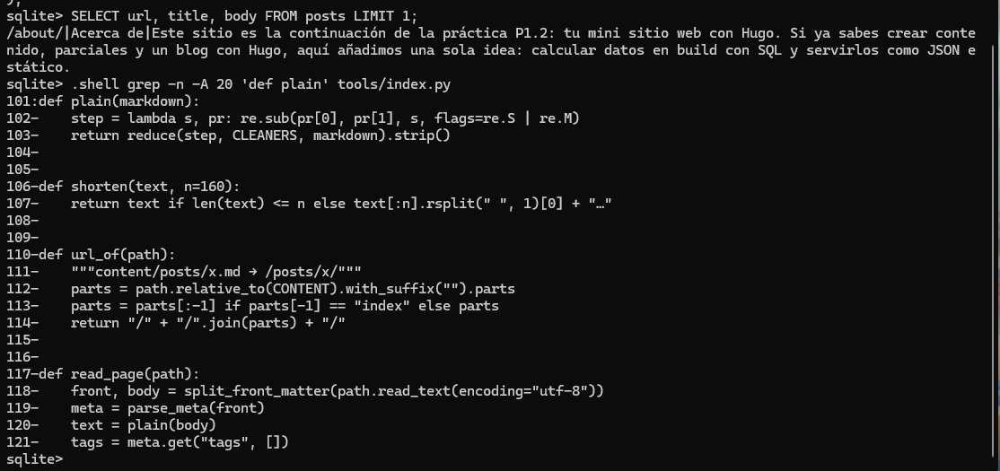

**Pregunta 3: ¿Qué contiene** `posts.body`**: el Markdown original o texto plano?**

La columna `posts.body` almacena texto plano, no el Markdown original.

Esto ocurre porque el script `tools/index.py` utiliza la función `plain()`, que aplica una serie de transformaciones para eliminar el formato Markdown antes de guardar el contenido en SQLite.

Lo he comprobado ejecutando una consulta SQL y revisando la función `plain()` del código.

Por tanto, al utilizar esta base de datos se puede perder información de formato, como negritas, enlaces o bloques de código.

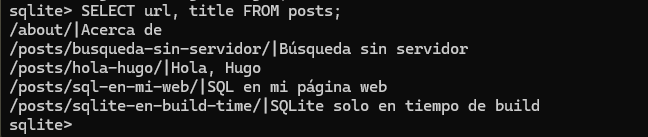

**Pregunta 4: ¿Qué pasa con las entradas en borrador (**`draft: true`**)? ¿Aparecen en** `build/site.db`**?**

Las entradas que tienen `draft: true` no aparecen en `build/site.db`, porque el script de indexación las excluye.

Lo he comprobado mediante la consulta `SELECT url, title FROM posts;`. Aparecen cuatro entradas publicadas y la página `/about/`, pero no aparece `borrador.md`, cuyo título es «Esto es un borrador».

Por tanto, la base de datos generada contiene únicamente las páginas y entradas que no están marcadas como borrador.

|                                   |                                      |                                                                            |
|-----------------------------------|--------------------------------------|----------------------------------------------------------------------------|
| Hugo (P1.1)                       | Chyrp Lite (P1.2)                    | Transformación necesaria                                                   |
| `title`                           | `post_attributes` → `title`          | Guardarlo como atributo                                                    |
| Cuerpo Markdown                   | `post_attributes` → `body`           | Conservar el Markdown original                                             |
| `date`                            | `posts.created_at`                   | Convertir al formato fecha y hora                                          |
| Nombre del archivo                | `posts.clean` y `posts.url`          | Eliminar `.md` y generar el slug                                           |
| `description` / `summary`         | Sin equivalente directo identificado | Se pierde si no añadimos un atributo                                       |
| `tags`                            | `post_attributes` → `tags`           | Convertir la lista en JSON                                                 |
| `draft: true`                     | `posts.status`                       | Asignar `draft`; si no, `public`                                           |
| Autor                             | `posts.user_id`                      | Asignar un usuario existente, como el ID 1                                 |
| `feather`, `pinned`, `updated_at` | Columnas de `posts`                  | Asignar valores adecuados, por ejemplo `text`, `0` y `1000-01-01 00:00:00` |

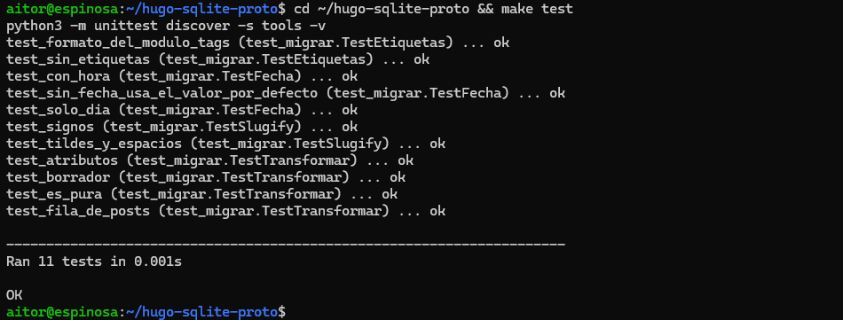

### **Parte 4.4 — Lectura guiada del script de migración**

**1. ¿Qué funciones tocan el disco o SQL y cuáles no? ¿Por qué** `test_migrar.py`** puede probar** `transformar` sin base de datos?

Las funciones `leer_entrada` y `extraer` leen archivos del disco. `comprobar_destino`, `buscar_autor`, `existe`, `insertar` y `cargar` trabajan con SQLite.

En cambio, `slugify`, `fecha_chyrp`, `etiquetas_json` y `transformar` son funciones puras: reciben datos y devuelven resultados sin leer archivos ni modificar la base de datos.

Por eso `test_migrar.py` puede comprobar `transformar` utilizando diccionarios de ejemplo, sin necesitar una base de datos.

2\. ¿Dónde empieza y termina la transacción? ¿Qué pasaría si falla el INSERT de la tercera entrada?

La transacción se gestiona dentro de `cargar`, mediante `with con:`.

Si todo funciona, se confirman los cambios mediante `COMMIT`. Si se produce un error durante la tercera entrada, SQLite realiza un `ROLLBACK` y deshace las inserciones anteriores de esa transacción.

Así evitamos dejar una migración incompleta.

3\. ¿Qué columna usa el script para saber si una entrada ya está migrada? ¿Es una buena elección? ¿Qué pasaría con dos ficheros del mismo nombre en carpetas distintas?

Utiliza la columna `url` de la tabla `posts`, mediante la función `existe`.

Es una elección sencilla para evitar duplicados, pero tiene una limitación: si dos archivos de carpetas diferentes tienen el mismo nombre, pueden generar el mismo slug.

El script consideraría que la segunda entrada ya existe y no la migraría, aunque fuera diferente.

**4. ¿Por qué** `etiquetas_json`** devuelve** `[]`** y no** `{}` cuando no hay etiquetas?

Porque Chyrp Lite almacena las entradas sin etiquetas utilizando el valor `[]`, como comprobamos en nuestra segunda entrada de prueba.

La función reproduce ese mismo formato para mantener la compatibilidad con la aplicación.

**5. ¿Por qué** `updated_at`** vale** `1000-01-01 00:00:00`? ¿De dónde sale ese valor?

Es el valor que utiliza Chyrp Lite para representar una entrada que todavía no se ha editado.

Lo comprobamos directamente en SQLite: nuestras dos entradas de prueba tenían ese valor en `updated_at`.

El script lo reutiliza mediante la constante `SQL_DATETIME_ZERO`.

**6. ¿Por qué se utiliza** `cur.lastrowid` entre los dos INSERT?

Porque primero se inserta la entrada en la tabla `posts` y SQLite genera automáticamente su identificador `id`.

Después, `cur.lastrowid` permite obtener ese identificador para guardarlo en `post_attributes.post_id`, relacionando el título, cuerpo y etiquetas con la entrada correcta.

**7. ¿Coincide** `transformar` con nuestra tabla de correspondencia? ¿Qué decisiones tomamos distintas?

Sí, coincide en las principales transformaciones: título y cuerpo como atributos, fecha en `created_at`, etiquetas en JSON, borradores mediante `status` y autor mediante `user_id`.

El script confirma que `feather` recibe `text`, `pinned` recibe `0` y `updated_at` recibe un valor fijo.

También conserva el cuerpo Markdown original, en lugar de utilizar el texto plano generado por el indexador de Hugo.

Nuestra tabla consideraba que `description` o `summary` no tenían un equivalente directo. El script tampoco los migra, por lo que esa información se pierde.

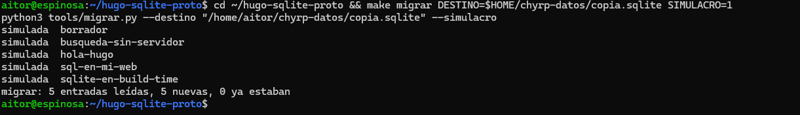

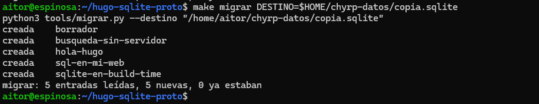

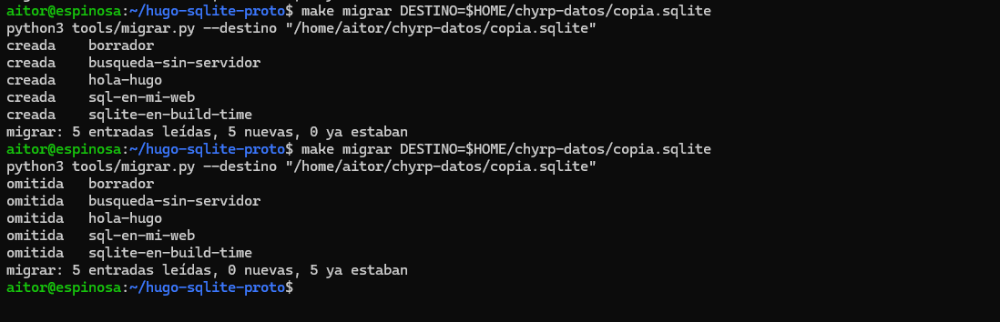

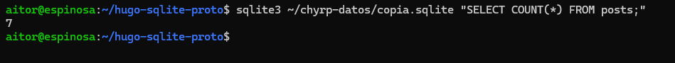

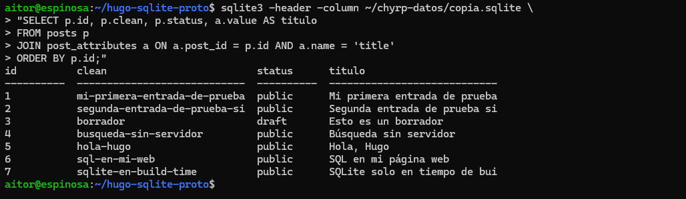

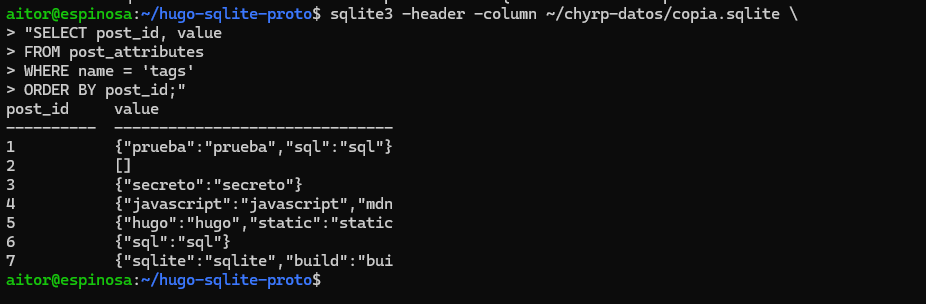

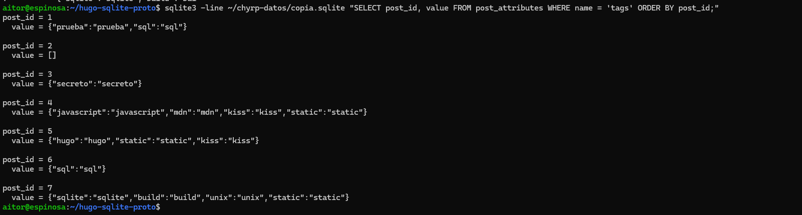

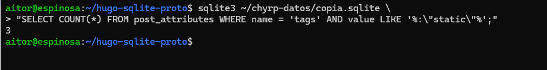

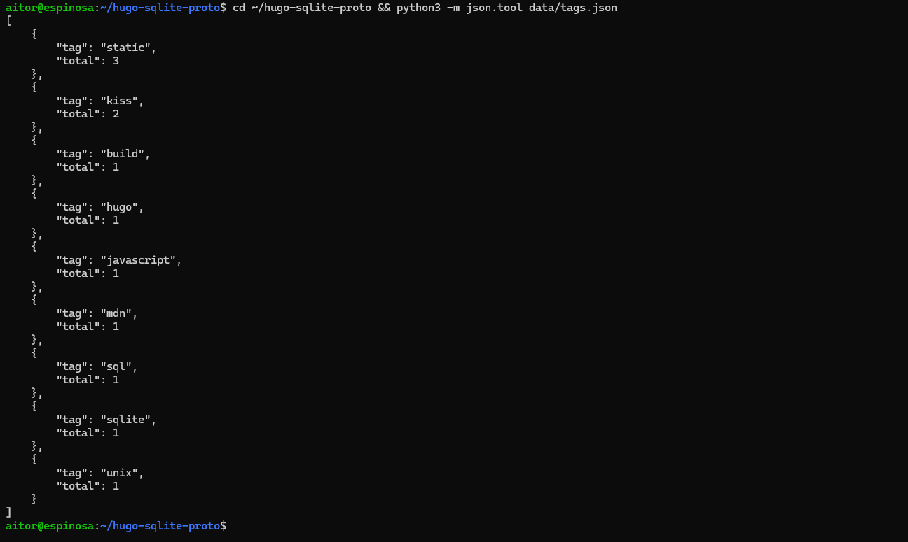

Comparación de etiquetas entre Hugo y Chyrp Lite

He comprobado que la etiqueta `static` aparece en 3 entradas en la base de datos de Chyrp Lite.

Después he consultado el archivo `data/tags.json` de Hugo y he obtenido también un total de 3 entradas.

Por tanto, los resultados coinciden y se confirma que las etiquetas se han migrado correctamente.

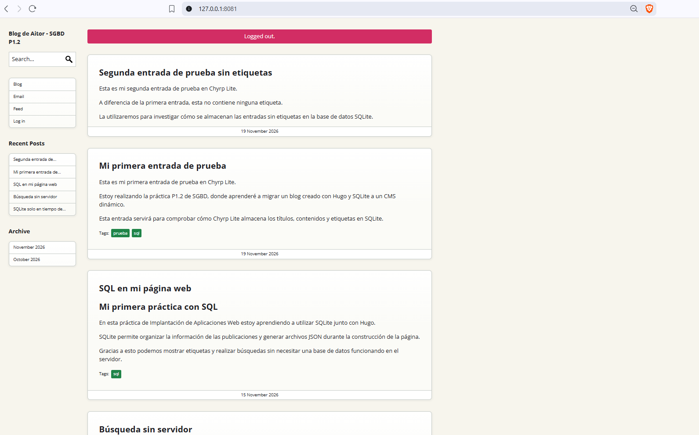

al pulsar **Older posts**.:

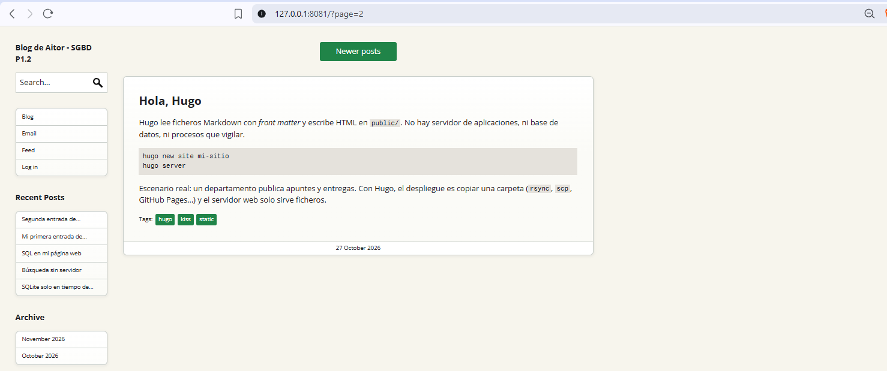

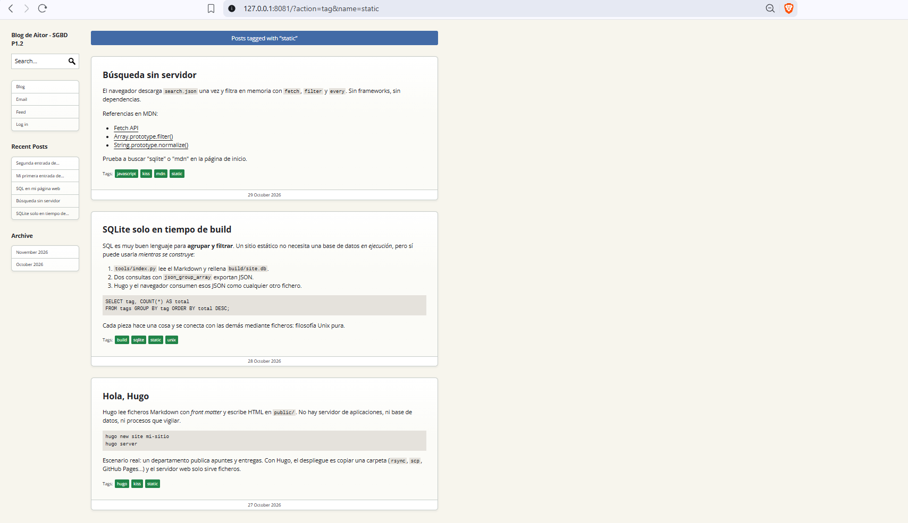

Borrador

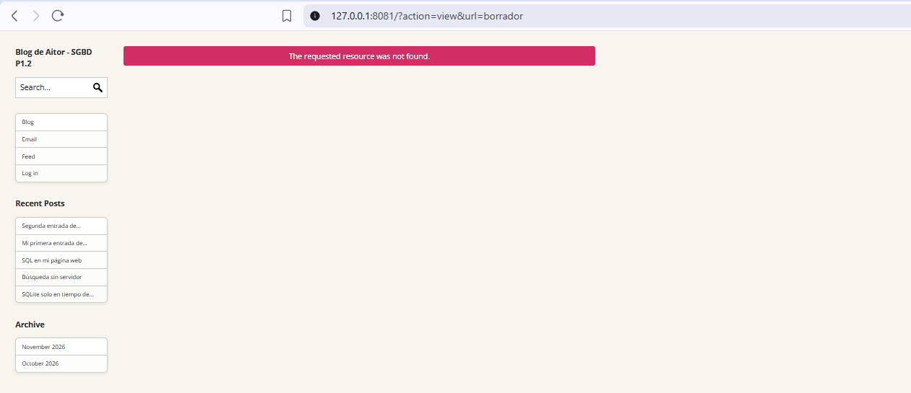

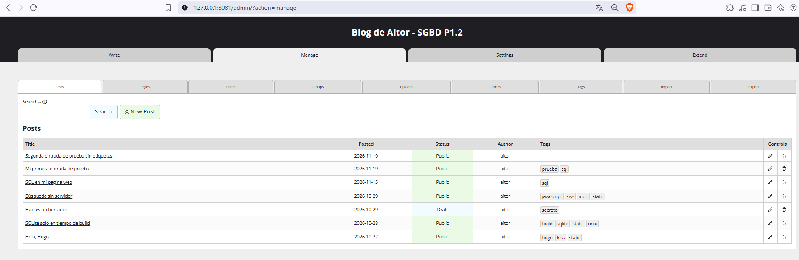

**Ejercicio 1. Romper la transacción a propósito**

Provocaremos un error durante la migración y comprobaremos qué ocurre con las entradas insertadas.

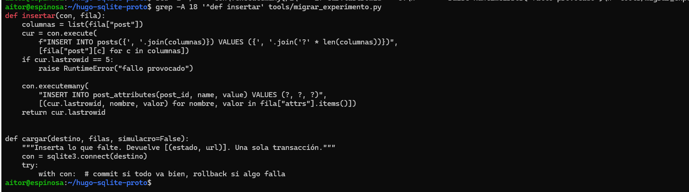

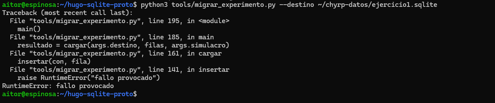

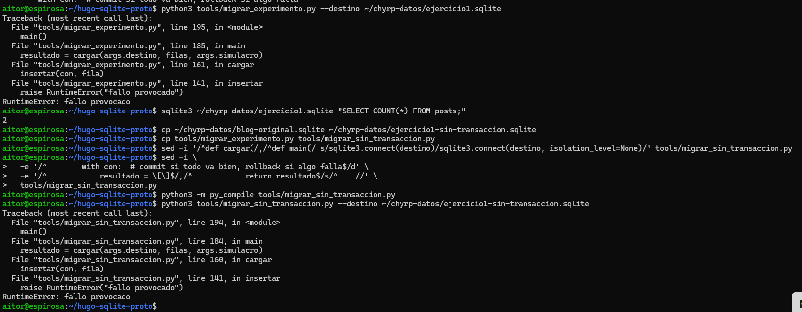

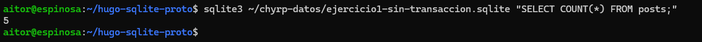

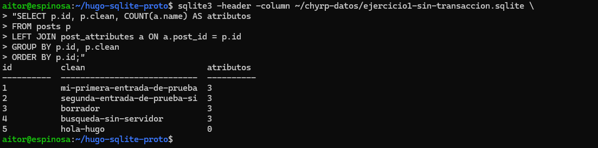

### **Ejercicio 1. Romper la transacción a propósito**

¿Qué he cambiado?

He creado una copia del script de migración y he añadido `raise RuntimeError("fallo provocado")` para provocar un error al insertar la tercera entrada nueva.

Primero he realizado la prueba manteniendo `with con:`, que gestiona la transacción. Después he repetido el experimento en otra copia de la base de datos, eliminando `with con:` y activando el modo autocommit.

¿Qué esperaba que ocurriera?

Con la transacción esperaba que SQLite deshiciera todas las inserciones realizadas durante la migración cuando apareciera el error.

Sin la transacción y con autocommit esperaba que las entradas anteriores al fallo quedaran guardadas, aunque la migración no terminara correctamente.

¿Cómo lo he comprobado?

He ejecutado ambos scripts sobre copias independientes de la base de datos y he utilizado `SELECT COUNT(*) FROM posts;` para contar las entradas.

|                              |                                |
|------------------------------|--------------------------------|
| **Prueba**                   | **Entradas después del fallo** |
| Con transacción              | 2                              |
| Sin transacción (autocommit) | 5                              |

También he consultado los atributos de cada entrada mediante un `LEFT JOIN` entre `posts` y `post_attributes`.

He descubierto que la entrada «Hola, Hugo», con ID 5, tenía 0 atributos porque el error ocurrió después de insertarla en `posts`, pero antes de guardar sus atributos.

¿Qué he aprendido?

He aprendido que las transacciones permiten mantener la integridad de la base de datos.

Si ocurre un error, `ROLLBACK` deshace los cambios de la transacción y evita que se guarden datos incompletos. Sin una transacción que agrupe las operaciones, algunas entradas pueden quedar guardadas a medias.

**Ejercicio 5 — Descubrir un límite: etiquetas numéricas**

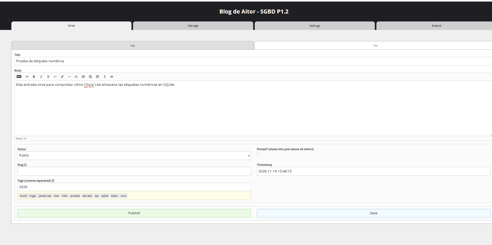

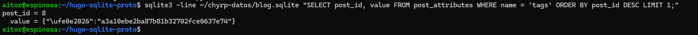

**Investigar el código de Chyrp Lite**

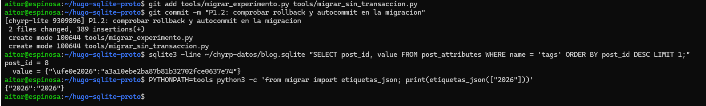

**Examinar el código PHP completo**

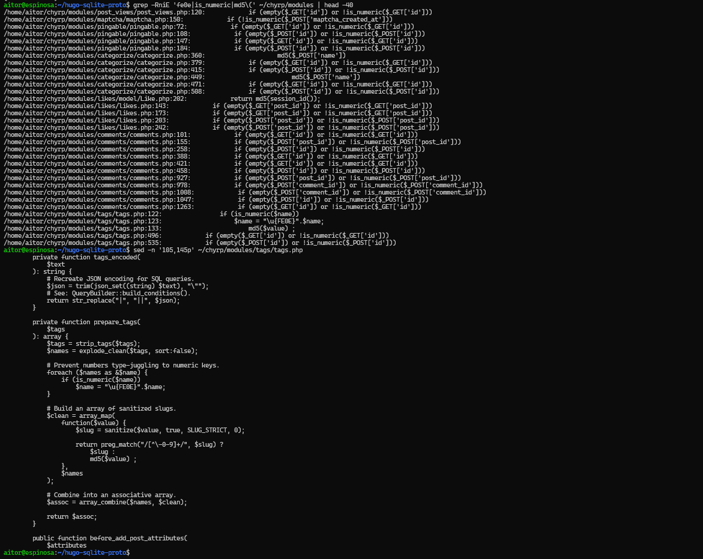

**Preparar la corrección de Python**

**Etiquetas numéricas**

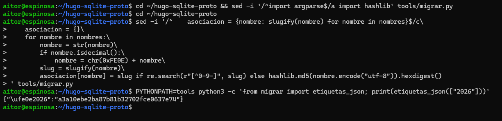

**Añadir una prueba automática** y  **Ejecutar todas las pruebas automáticas**

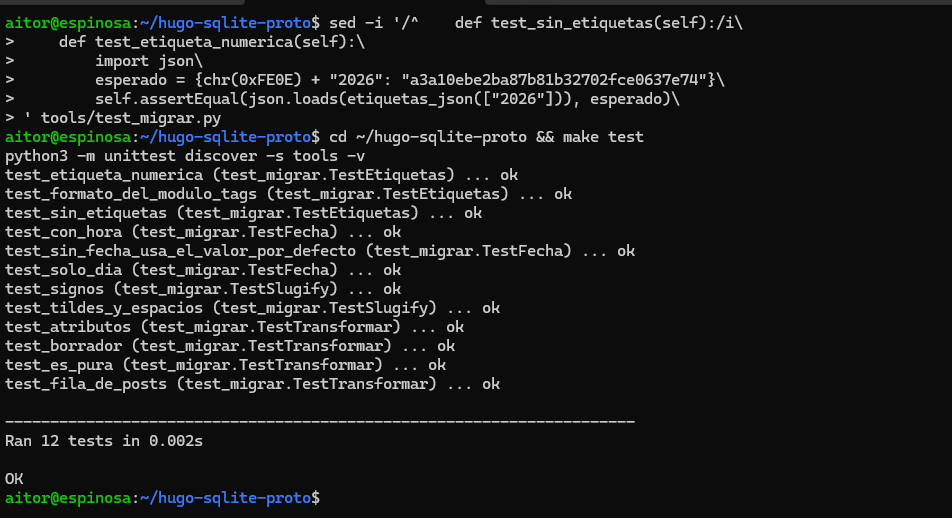

### **Ejercicio 5 — Descubrir un límite: etiquetas numéricas**

Creé una entrada en Chyrp Lite con la etiqueta `2026` y consulté cómo se almacenaba en SQLite.

**Resultado de Chyrp Lite:  
**`{"\ufe0e2026":"a3a10ebe2ba87b81b32702fce0637e74"}`

**Resultado inicial de mi función Python:  
**`{"2026":"2026"}`

Los resultados no coincidían. Al investigar el código PHP de Chyrp Lite, descubrí que añade el carácter Unicode `FE0E` delante de las etiquetas numéricas y utiliza un hash MD5 para generar su identificador.

Corregí la función `etiquetas_json()` para reproducir ese comportamiento con la etiqueta `2026` y añadí la prueba automática `test_etiqueta_numerica`.

**Comprobación final:** ejecuté `make test` y las 12 pruebas terminaron correctamente (`OK`).

## Mini-reto: crea una entrada nueva y mírala en la BD

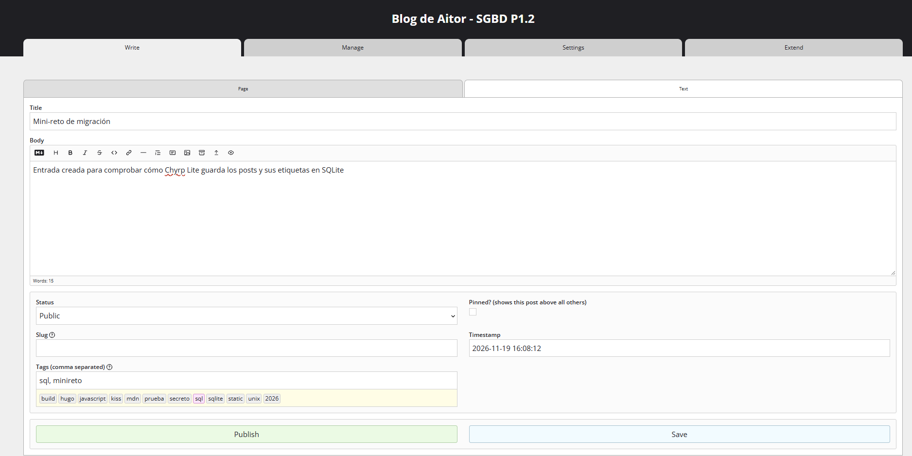

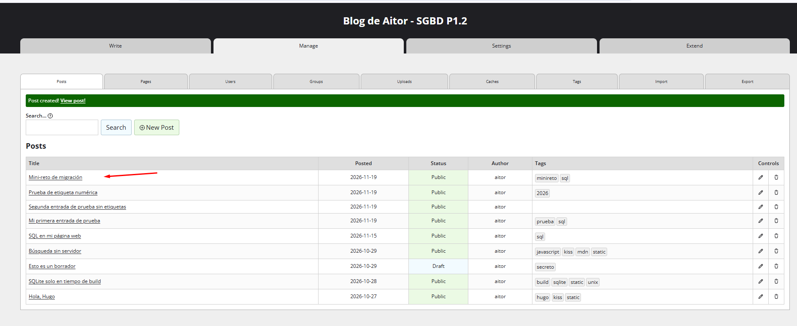

**Comprobar la nueva entrada en SQLite**

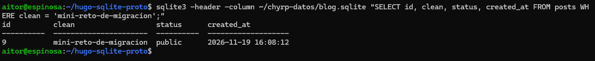

**Comprobar los atributos y etiquetas**

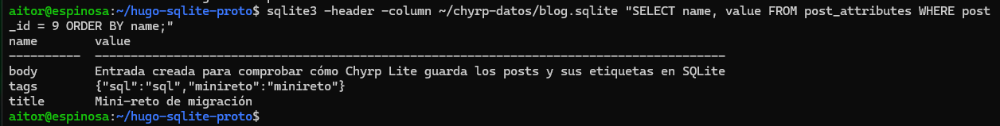

**Buscar las entradas con la etiqueta** `sql`

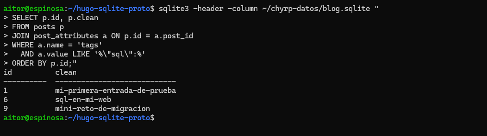

**Comparar con las etiquetas de Hugo**

### **Mini-reto — Crear una entrada y comprobar SQLite**

Creé desde Chyrp Lite una entrada titulada **«Mini-reto de migración»**, con dos etiquetas: `sql` (ya existente) y `minireto` (nueva).

Al consultar SQLite comprobé que se había creado un registro en la tabla `posts`, con ID `9` y estado `public`.

En la tabla `post_attributes` encontré tres registros asociados a esa entrada: `title`, `body` y `tags`. Las etiquetas se almacenaron en formato JSON:

`{"sql":"sql","minireto":"minireto"}`

Después busqué las entradas con la etiqueta `sql`. En Chyrp Lite encontré **3 entradas**, utilizando `LIKE` sobre el valor JSON. En la base de datos original de Hugo encontré **1 entrada**, utilizando un `JOIN` entre `posts` y `tags`.

Los resultados tienen cantidades diferentes porque en Chyrp Lite también hay entradas creadas manualmente.

**Conclusión:** Hugo utiliza una tabla independiente para las etiquetas, lo que facilita las consultas SQL. Chyrp Lite almacena las etiquetas dentro de un atributo JSON, un diseño más flexible, pero que puede complicar determinadas búsquedas.

### **Reflexión 1 — Fallo de SQLite en producción**

En Hugo, SQLite se utiliza durante la generación de la web. Si la base de datos falla después de generar el sitio, los visitantes pueden seguir accediendo a las páginas HTML estáticas, aunque no se podría volver a generar correctamente el contenido que depende de SQLite hasta solucionar el problema.

En Chyrp Lite, SQLite se utiliza directamente para consultar las entradas del blog. Si la base de datos falla, los visitantes podrían dejar de ver las publicaciones y el administrador no podría gestionarlas.

Conclusión: Hugo depende menos de SQLite durante las visitas porque genera páginas estáticas, mientras que Chyrp Lite necesita la base de datos para funcionar dinámicamente.

### **Reflexión 2 — Accesos simultáneos y SQLite**

SQLite puede atender a muchos visitantes que estén leyendo el blog al mismo tiempo, por lo que 50 visitas simultáneas no tienen por qué causar problemas.

La principal limitación aparece cuando varios usuarios intentan escribir en la base de datos a la vez, ya que SQLite solo permite una transacción de escritura simultánea. Esto puede provocar esperas o errores de bloqueo (database is locked).

Si el blog creciera mucho y tuviera numerosas escrituras simultáneas, comentarios o usuarios publicando contenido, sería recomendable utilizar MySQL o PostgreSQL, que están diseñados para gestionar mejor la concurrencia.

Conclusión: SQLite es una buena opción para un blog pequeño, pero una base de datos cliente-servidor puede ser más adecuada cuando aumenta la actividad simultánea.

### **Reflexión 3 — Copias de seguridad**

En Chyrp Lite habría que guardar una copia de la base de datos SQLite (`blog.sqlite`), los archivos subidos al blog y los archivos de configuración. Así podríamos recuperar las publicaciones, usuarios, ajustes e imágenes en caso de fallo.

En una web estática de Hugo, bastaría con conservar el código fuente del proyecto, los archivos Markdown, las imágenes y la configuración. Las páginas HTML se pueden generar de nuevo.

Conclusión: en Chyrp Lite es fundamental hacer copias de seguridad periódicas de la base de datos, porque el contenido cambia desde el propio CMS. En Hugo, gran parte del sitio se puede reconstruir desde sus archivos fuente.

### **Reflexión 4 — Normalización y almacenamiento de etiquetas**

En Hugo, las etiquetas se almacenan en una tabla independiente (`tags`), con una fila por etiqueta. Esto permite realizar búsquedas mediante `JOIN` y facilita consultar, filtrar y contar etiquetas.

En Chyrp Lite, las etiquetas se guardan juntas en formato JSON dentro de `post_attributes`. Este diseño permite almacenar distintos atributos sin modificar la estructura de la tabla, pero puede complicar las consultas SQL.

Conclusión: el modelo de Hugo está más normalizado y facilita las consultas sobre etiquetas, mientras que el de Chyrp Lite ofrece mayor flexibilidad para gestionar los atributos de las publicaciones.

### **Reflexión 5 — Riesgos de modificar directamente la base de datos**

Escribir directamente en las tablas de Chyrp Lite puede provocar errores si no respetamos su estructura, sus relaciones o las reglas internas del CMS.

Por ejemplo, podríamos crear publicaciones sin sus atributos, guardar etiquetas con un formato incorrecto o introducir datos que el programa no pueda interpretar.

Una alternativa más segura sería utilizar una API oficial o una herramienta de importación del propio CMS, porque permitiría validar los datos antes de guardarlos.

Conclusión: modificar directamente la base de datos puede servir para una migración controlada, pero es importante hacer copias de seguridad, utilizar transacciones y comprobar los resultados.

### **Reflexión 6 — Limitaciones del módulo de migración**

El módulo de migración de Chyrp Lite no puede importar directamente nuestro proyecto Hugo porque está preparado para reconocer determinados formatos y sistemas de origen, pero no la estructura personalizada de nuestra base de datos SQLite.

En nuestro caso, Hugo almacena las publicaciones y etiquetas en las tablas `posts` y `tags`, mientras que Chyrp Lite utiliza `posts` y `post_attributes`, con una estructura diferente.

Para importar nuestro proyecto, el módulo necesitaría un adaptador capaz de leer la base de datos de Hugo, transformar los campos al formato de Chyrp Lite y conservar correctamente las fechas, etiquetas, contenido y estados de las publicaciones.

**Conclusión:** por eso hemos utilizado un proceso ETL propio, que extrae, transforma y carga los datos entre ambos sistemas.
